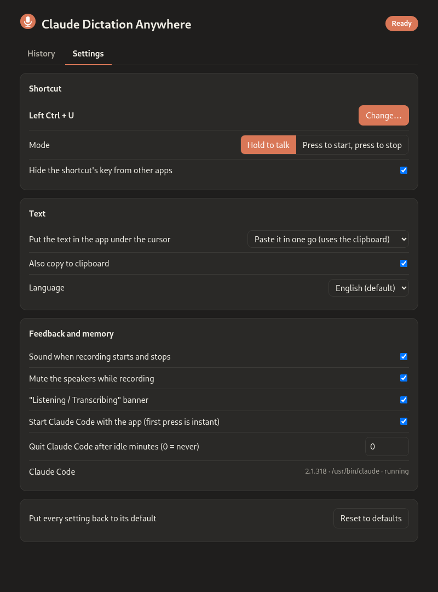

# Claude Dictation Anywhere

**Borrow Claude Code's dictation and use it anywhere.** Hold a key, speak, let go: your words appear wherever the cursor is. A Google search box, Slack, an email, a terminal.

A free alternative to paid dictation apps like Wispr Flow. If you already pay for Claude, there's no second subscription.


> Unofficial. Not made by or affiliated with Anthropic. "Claude" and "Claude Code" are Anthropic's trademarks. Wispr Flow is a trademark of its owner.

## Why

Claude Code's `/voice` dictation is quick and accurate, and it comes with your Claude subscription: it doesn't use Claude messages or tokens, and it doesn't count toward your usage limits. But it only works inside Claude Code. This app makes it work in every app.

|  | Claude Dictation Anywhere | Wispr Flow |
|---|---|---|
| Price | Free with a Claude subscription you already have | Free tier capped at 2,000 words/week; Pro about \$15/month |
| Linux | ✅ (Wayland and X11) | No Linux app listed |
| macOS | ✅ | ✅ |
| Windows | ❌ | ✅ |
| Speech engine | Claude Code's own `/voice` | Wispr's own service |
| Word limits | None of its own | Free tier capped |
| Code | Source on GitHub | Closed |

Wispr Flow details as published in October 2026; check its site for current plans.

## Features

- 🎙 **Push-to-talk or toggle:** hold the shortcut, or press once to start and again to stop.
- ⌨️ **Any key, key combination, or mouse button:** function keys, right Ctrl or Command, Control + Option, mouse side or sniper buttons. Set it by pressing it.
- 📋 **Typed and copied:** text lands at your cursor and on your clipboard.
- 🛟 **Nothing lost:** text that could not be delivered waits on the settings page, in memory only, with a Copy button. It is never typed twice.
- 🕘 **History:** every transcript is kept on your computer, ready to copy again.
- 🔇 **Mutes your speakers while you talk:** music or a podcast playing in any app won't leak into the transcript. Sound comes back the moment you let go. On by default.
- 🟠 **Always visible:** the tray icon changes colour, a short sound plays, and a small "Listening…" banner appears (a pill at the bottom of the screen on macOS, a notification on Linux). It never takes focus from the app you're typing in.
- 🌍 **20 languages:** every language Claude Code's dictation supports.
- 🪶 **Uses your own Claude Code:** nothing bundled, no API key, no extra account.



📖 **[Wiki](https://github.com/GerardWu100/claude-dictation-anywhere/wiki):** installation, how it works, choosing a shortcut, troubleshooting, FAQ.

## How it works

```
hold the shortcut ──► the app runs your installed `claude` in a hidden terminal
                      and "holds Space" in it ──► Claude Code's /voice records
release ────────────► the transcript lands in Claude Code's prompt box (never sent)
                    ► once Claude Code's footer says it is final, the app pulls it out
                      (Ctrl+G, "edit in external editor")
                    ► copies it to the clipboard and types it where your cursor is
```

- **Your login stays in Claude Code.** The app never reads your token or calls Anthropic itself. It only presses keys in the real `claude` program, and it presses nothing on a screen it does not recognise.
- **No prompt is ever sent to the model,** so it uses no tokens. The hidden session runs with no tools at all.
- **It doesn't bundle Claude Code.** It finds the `claude` already on your system and runs whatever version you have installed.

## Requirements

- [Claude Code](https://claude.com/claude-code), logged in with a Claude.ai account (`claude`, then `/login`). Dictation doesn't work with an API key.
- Python 3.13+ and [uv](https://docs.astral.sh/uv/).
- **Linux:**
  - Your user in the `input` group, to read the shortcut key.
  - [`ydotool`](https://github.com/ReimuNotMoe/ydotool) with `ydotoold` running, to type the text.
  - `wl-clipboard` (Wayland) or `xclip` (X11), to copy it to the clipboard.
  - On GNOME, the AppIndicator extension for the tray icon.
- **macOS:** in System Settings → Privacy & Security, turn on the app you start it from (its own app, or Terminal, Ghostty, iTerm…) under:
  - **Input Monitoring**, to read the shortcut.
  - **Accessibility**, to type or paste the text.
  - **Microphone**: the app asks on its first start. Answer that prompt; until you do, Claude Code freezes at "keep holding…".

  The settings page names the app to turn on and has a button that opens the right page in System Settings. Restart the app if a warning stays after you allow it.

## Install and run

```bash
uv tool install git+https://github.com/GerardWu100/claude-dictation-anywhere
claude-dictation-anywhere
```

Or from a clone: `uv run claude-dictation-anywhere`.

Add it to your app search once, so you can start it without a terminal:

```bash
claude-dictation-anywhere --install-launcher
```

- **Linux (GNOME, KDE):** start it from the app search. Opening it again while it runs opens its settings page.
- **macOS:** this builds `~/Applications/Claude Dictation Anywhere.app`, so Spotlight finds it. It has its own permissions, separate from your terminal's, so allow them once more. *The macOS app is new and has not yet been checked on a real Mac; starting from a terminal still works.*

`--uninstall-launcher` removes it. To get a newer version, run `uv tool upgrade claude-dictation-anywhere` and restart the app.

A microphone icon appears in the tray or menu bar, and the settings page opens in your browser the first time. Click the icon → **Settings and history…** to open it again.

| Tray icon colour | Meaning |
|---|---|
| Orange | Ready |
| Amber | Starting Claude Code |
| Red | Listening |
| Blue | Transcribing |
| Grey | Paused |
| Purple | Waiting for a new shortcut |
| Dark | Stopped working; restart the app |

## Settings

All of these are on the settings page:

- **Shortcut:** press **Change…**, then press any key or mouse button, or hold several keys together and let go (for example Control + Option). Function keys, modifiers, combinations, and mouse side or sniper buttons all work. A combination fires once all its keys are down and stops when you let go of any of them. Shortcuts that would type text are refused. On macOS the G in Command + Option + G does not reach the app you are in, and G pressed alone still types G. On Linux the same holds with the next setting on; with it off, the settings page warns that the key also reaches the app.
- **Stop the shortcut doing its normal job** (Linux): needed for mouse side buttons, which otherwise also mean Back, and for the G in Ctrl + Alt + G. Modifiers in a combination keep working, so Ctrl + C is unaffected. On macOS this is always on for keys that are not modifiers.
- **Mode:** *Hold to talk*, or *Press to start, press to stop*. A press while the last recording is still transcribing is ignored, so wait for the blue icon to clear.
- **Text:** type it, paste it, or don't insert it. Optionally also copy it to the clipboard. With copying off, nothing is written to the clipboard, not even after a failure; only paste mode uses it, because pasting works that way. Typed text has its line breaks and tabs replaced by spaces, because a typed line break is an Enter key and a typed tab moves the focus.
- **Mute the speakers while recording:** on by default. Mutes the default output (your volume level is untouched) and unmutes when you release; if it was already muted, it stays muted. If you switch outputs while recording, the one that was muted is the one unmuted. If you press mute yourself while recording, it still unmutes at release.
- **Pause shortcut** (tray menu): stops a recording at once and discards its text. Text already recorded is kept on the settings page instead of being typed.
- **Language:** any of the 20 languages Claude Code's dictation supports.
- **Memory:**
  - The hidden Claude Code uses about 250 MB. Turn off *Start Claude Code with the app* and it only starts on your first press, adding about 2 seconds that once.
  - By default it keeps running, so every press records at once. You can have it quit after a set number of idle minutes instead; the next press then waits 1–3 seconds for it to restart, and words spoken during that wait are lost.
- **History:** recent transcripts, with copy buttons. The history is stored only on your computer, and you can turn it off.

Command-line check without any shortcut: `claude-dictation-anywhere --test 5` records 5 seconds and prints the text.

## Privacy

Your audio goes to Anthropic exactly as it does when you use `/voice` in Claude Code, under your Claude account's data settings. Transcript history stays on your computer:

- Linux: `~/.local/share/claude-dictation-anywhere/`
- macOS: `~/Library/Application Support/claude-dictation-anywhere/`

The settings page is served only on `127.0.0.1`, behind a random token for each run, and it refuses requests addressed to any other host name. History, logs, settings, and the temporary transcript hand-off are readable only by your user account; that does not protect them from other programs running as you. Logs hold states, durations, and character counts, never your words. Text kept for recovery stays in memory and is gone when the app quits.

## Limits

- It depends on Claude Code's screen and keys. A Claude Code update can break it until this app is updated; see Compatibility.
- One recording can last at most about 2 minutes (Claude Code's own limit).
- Linux "type" mode types only characters on a US keyboard. Text with accents or other alphabets is not typed at all, rather than typed with letters missing: it waits on the settings page, and on the clipboard if copying is on. Use "paste" mode for those, and for non-US layouts. Paste presses Ctrl+V, which most Linux terminals do not treat as paste.
- The target is the app in front when you release. On macOS, if another app is in front when the text is ready, or you switch while it types, typing stops; another window or tab of the same app is not noticed. On Linux the front window cannot be read on Wayland, so the text goes into whatever has focus then.
- macOS: Caps Lock cannot be the shortcut, because macOS reports it as locked, not as held. Hiding a shortcut's key from other apps needs Accessibility, even with text insertion off; the settings page warns if it is missing.

## Compatibility

Checked end to end with Claude Code **2.1.309** on macOS and **2.1.314** on Linux (GNOME on Wayland). The app relies on these options and screen states:

- Options: `--safe-mode`, `--strict-mcp-config`, `--disable-slash-commands`, `--tools ""`, `--settings`, the `EDITOR` variable for Ctrl+G, and `claude auth status` to tell an expired sign-in from a network failure.
- Footer words: `keep holding…` and `listening…` (both in Claude Code's voice docs), and `Voice: processing…` (observed, undocumented).
- Prompt box: a `❯` row directly under a rule line. The first-run trust dialog is answered only if it reads exactly as recorded.

| If Claude Code changes | What happens | What to do |
|---|---|---|
| Any screen is unrecognised | Nothing is pressed; an error explains | Run `claude`, answer it, quit it, press again |
| An option is removed or too new | "Update it" error at startup | `claude update` |
| `Voice: processing…` is reworded | Falls back to waiting for a quiet screen, which can cut off slow text | Update this app |
| Text does not finish within 12 s | Offered on the settings page, not typed; the session restarts | Copy it, dictate again |
| The sign-in has expired | Says so when the app starts, or at the press; no more Spaces are sent for that press, so Claude Code does not keep retrying | Run `claude`, type `/login`, quit it, press again |
| The voice service cannot be reached | Same: one attempt per press, and an error | Check your network or VPN, press again |

Run `claude-dictation-anywhere --test 5` to check everything end to end. It sends one real dictation.

## Account use

This app runs your own unmodified `claude`, signed in through Anthropic's own flow; it never touches your credentials and sends one dictation per key press. Anthropic's [Claude Code legal page](https://code.claude.com/docs/en/legal-and-compliance) allows you to sign in to the unmodified binary, and says subscription sign-in is meant for "ordinary use" of Claude Code. It does not settle using `/voice` transcripts outside Claude Code, and Anthropic may enforce its terms without notice. Anthropic has not endorsed this app, and no one can promise your account is safe: use it at your own judgment, and read the [Consumer Terms](https://www.anthropic.com/legal/consumer-terms) and [voice docs](https://code.claude.com/docs/en/voice-dictation). If Claude Code denies sign-in, permission, or usage, the app stops and tells you; it never retries around a denial.

## License

[MIT](LICENSE)
