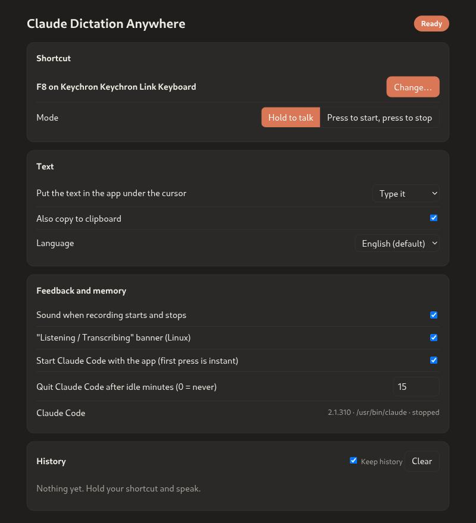

# Claude Dictation Anywhere

**Borrow Claude Code's dictation and use it anywhere.** Hold a key, speak, let go: your words appear wherever the cursor is. A Google search box, Slack, an email, a terminal.

A free alternative to paid dictation apps like Wispr Flow. If you already pay for Claude, there's no second subscription.


> Unofficial. Not made by or affiliated with Anthropic. "Claude" and "Claude Code" are Anthropic's trademarks. Wispr Flow is a trademark of its owner.

## Why

Claude Code's `/voice` dictation is quick and accurate, and it comes with your Claude subscription: it doesn't use Claude messages or tokens, and it doesn't count toward your usage limits. But it only works inside Claude Code. This app makes it work in every app.

|  | Claude Dictation Anywhere | Wispr Flow |
|---|---|---|
| Price | Free with a Claude subscription you already have | Free tier capped at 2,000 words/week; Pro about \$15/month |
| Linux | ✅ (Wayland and X11) | No Linux app listed |
| macOS | ✅ (not yet tested) | ✅ |
| Windows | ❌ | ✅ |
| Speech engine | Claude Code's own `/voice` | Wispr's own service |
| Word limits | None of its own | Free tier capped |
| Code | Source on GitHub | Closed |

Wispr Flow details as published in October 2026; check its site for current plans.

## Features

- 🎙 **Push-to-talk or toggle:** hold the shortcut, or press once to start and again to stop.
- ⌨️ **Any key or mouse button:** function keys, right Ctrl or Command, mouse side or sniper buttons. Set it by pressing it.
- 📋 **Typed and copied:** text lands at your cursor and on your clipboard.
- 🕘 **History:** every transcript is kept on your computer, ready to copy again.
- 🟠 **Always visible:** tray icon colours plus a short sound show when it's listening.
- 🌍 **20 languages:** every language Claude Code's dictation supports.
- 🪶 **Uses your own Claude Code:** nothing bundled, no API key, no extra account.



## How it works

```
hold the shortcut ──► the app runs your installed `claude` in a hidden terminal
                      and "holds Space" in it ──► Claude Code's /voice records
release ────────────► the transcript lands in Claude Code's prompt box (never sent)
                    ► the app pulls it out (Ctrl+G, "edit in external editor")
                    ► copies it to the clipboard and types it where your cursor is
```

- **Your login stays in Claude Code.** The app never reads your token or calls Anthropic itself. It only presses keys in the real `claude` program.
- **No prompt is ever sent to the model,** so it uses no tokens. The hidden session runs with no tools at all.
- **It doesn't bundle Claude Code.** It finds the `claude` already on your system and runs whatever version you have installed.

## Requirements

- [Claude Code](https://claude.com/claude-code), logged in with a Claude.ai account (`claude`, then `/login`). Dictation doesn't work with an API key.
- Python 3.13+ and [uv](https://docs.astral.sh/uv/).
- **Linux:**
  - Your user in the `input` group, to read the shortcut key.
  - [`ydotool`](https://github.com/ReimuNotMoe/ydotool) with `ydotoold` running, to type the text.
  - `wl-clipboard` (Wayland) or `xclip` (X11), to copy it to the clipboard.
  - On GNOME, the AppIndicator extension for the tray icon.
- **macOS** (written for it, not yet tested): allow the app that starts it (your terminal) under System Settings → Privacy & Security → Accessibility, Input Monitoring, and Microphone.

## Install and run

```bash
uv tool install git+https://github.com/GerardWu100/claude-dictation-anywhere
claude-dictation-anywhere
```

Or from a clone: `uv run claude-dictation-anywhere`.

A microphone icon appears in the tray or menu bar, and the settings page opens in your browser the first time. Click the icon → **Settings and history…** to open it again.

| Tray icon colour | Meaning |
|---|---|
| Orange | Ready |
| Amber | Starting Claude Code |
| Red | Listening |
| Blue | Transcribing |
| Grey | Paused |

## Settings

All of these are on the settings page:

- **Shortcut:** press **Change…**, then press any key or mouse button. Function keys, right-hand modifiers, and mouse side or sniper buttons all work. Keys that type text are refused.
- **Mode:** *Hold to talk*, or *Press to start, press to stop*.
- **Text:** type it, paste it, or don't insert it. Optionally also copy it to the clipboard.
- **Language:** any of the 20 languages Claude Code's dictation supports.
- **Memory:**
  - The hidden Claude Code uses about 250 MB. Turn off *Start Claude Code with the app* and it only starts on your first press, adding about 2 seconds that once.
  - It quits after a set number of idle minutes (default 15).
- **History:** recent transcripts, with copy buttons. The history is stored only on your computer, and you can turn it off.

Command-line check without any shortcut: `claude-dictation-anywhere --test 5` records 5 seconds and prints the text.

## Privacy

Your audio goes to Anthropic exactly as it does when you use `/voice` in Claude Code, under your Claude account's data settings. Transcript history stays on your computer:

- Linux: `~/.local/share/claude-dictation-anywhere/`
- macOS: `~/Library/Application Support/claude-dictation-anywhere/`

The settings page is served only on `127.0.0.1`, behind a random token for each run.

## Limits

- It depends on Claude Code's screen and keys. A Claude Code update can break it until this app is updated; run `--test 5` to check.
- One recording can last at most about 2 minutes (Claude Code's own limit).
- Linux "type" mode types only characters on a US keyboard. Use "paste" mode for accents.
- On GNOME Wayland, if you switch windows while it is transcribing, the text goes into the new window.
- Anthropic's consumer terms limit automated use of its services. This app sends one ordinary dictation per key press through the real Claude Code, but Anthropic hasn't endorsed using it this way. Use it at your own judgment.

