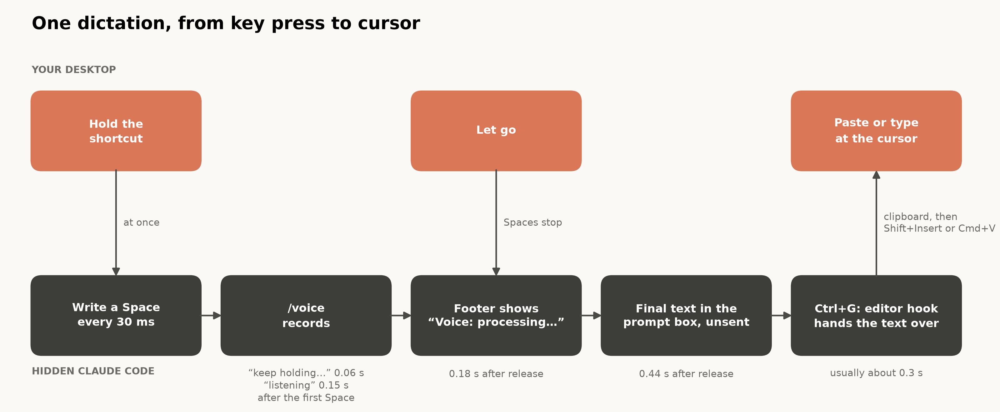
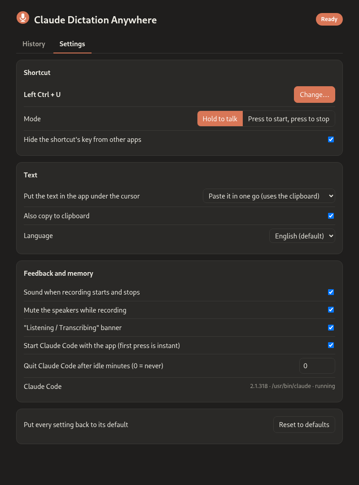

# Emprunter la dictée /voice de Claude Code pour toutes les applications

Claude Code a une commande `/voice` : on maintient Espace, on parle, et la transcription apparaît dans la zone de saisie. Elle est rapide et précise, et elle est incluse dans un abonnement Claude. Elle n'utilise ni messages ni jetons Claude, et elle ne compte pas dans les limites d'utilisation. Mais elle ne fonctionne que dans Claude Code, et je la voulais aussi dans un champ de recherche du navigateur, dans Slack, dans mes courriels et dans un terminal.

[Claude Dictation Anywhere](https://github.com/GerardWu100/claude-dictation-anywhere) fait exactement cela. Vous maintenez un raccourci, vous parlez, vous relâchez, et le texte apparaît sous votre curseur et dans votre presse-papiers. L'application tourne sous Linux (Wayland et X11) et macOS, sous licence MIT. Elle n'est pas officielle : Anthropic ne l'a pas créée et n'y est pas affiliée. « Claude » et « Claude Code » sont des marques d'Anthropic.

Le raccourci peut être n'importe quelle touche, combinaison ou bouton de souris, en mode « maintenir pour parler » ou « appuyer pour démarrer, appuyer pour arrêter ». L'application coupe le son de vos haut-parleurs pendant que vous parlez, prend en charge les 20 langues de la dictée de Claude Code et n'embarque rien. Elle ne demande ni clé d'API ni compte supplémentaire, car elle utilise le `claude` déjà installé.

Le produit payant le plus proche que je connaisse est Wispr Flow. Ses informations ci-dessous sont celles publiées en octobre 2026 :

|  | Claude Dictation Anywhere | Wispr Flow |
|---|---|---|
| Prix | Gratuit avec l'abonnement Claude que vous avez déjà | Offre gratuite limitée à 2 000 mots/semaine ; Pro environ 15 \$/mois |
| Plateformes | Linux (Wayland, X11), macOS | macOS, Windows ; aucune application Linux annoncée |
| Moteur vocal | Le `/voice` de Claude Code | Le service de Wispr |
| Code | Source sur GitHub | Fermé |

Sous Windows, ou sans abonnement Claude, Wispr Flow reste le meilleur choix.

## Piloter /voice depuis un terminal caché

J'aurais pu lire le jeton de connexion de Claude Code et appeler directement son service vocal. Je ne l'ai pas fait, car les conditions d'Anthropic réservent la connexion par abonnement à un usage ordinaire de Claude Code lui-même, et un client fait maison pourrait mettre le compte en danger. L'application ne lit jamais les identifiants. Elle lance le vrai programme `claude`, non modifié, dans un pseudo-terminal (pty), c'est-à-dire un faux terminal qu'un programme peut piloter pour un autre, et elle appuie sur des touches comme le ferait une personne.

Dans un terminal, une barre d'espace maintenue n'est qu'un caractère Espace répété environ toutes les 30 ms. Claude Code reconnaît une touche « maintenue » à ce rythme, et l'application l'imite :

```python
def _hold_space(self, session, press: Event, toggle: bool, started: float) -> None:
    while time.monotonic() - started < MAX_RECORDING_S and self._cancel_reason is None:
        if session.voice_failed():
            log.info("voice reported a failure; no more Spaces for this press")
            return
        session.press_space()
        try:
            event = self.events.get(timeout=KEY_REPEAT_INTERVAL_S)
        except queue.Empty:
            continue
        if toggle and event.kind == PRESS:
            return
        if not toggle and event.kind == RELEASE and event.gesture == press.gesture:
            return
```

Les Espaces partent dès l'appui. Lors d'une mesure, Claude Code affichait « listening » 0,15 s après le premier Espace, et les mots prononcés avant sont perdus. La couleur de l'icône, la bannière, le son de départ et la coupure du son prennent ensemble environ 0,3 s : ils tournent donc dans un autre fil d'exécution. De plus, `voice_failed()` arrête la boucle au premier message d'erreur, car chaque Espace supplémentaire pousse Claude Code à se reconnecter. Un appui donne une seule tentative.

La session cachée démarre avec tout désactivé, sauf la dictée :

```python
CLAUDE_BASE_FLAGS = [
    "--safe-mode",
    "--strict-mcp-config",
    "--disable-slash-commands",
    "--tools",
    "",
]

def build_claude_args(claude_path: str, language: str) -> list[str]:
    settings = {"voice": {"enabled": True, "mode": "hold", "autoSubmit": False}}
    if language:
        settings["language"] = language
    return [claude_path, *CLAUDE_BASE_FLAGS, "--model", HIDDEN_SESSION_MODEL,
            "--settings", json.dumps(settings)]
```

Le mode sans échec ignore votre `CLAUDE.md`, vos hooks, vos plugins et vos serveurs MCP. Sans outils, même une requête envoyée par erreur ne pourrait toucher aucun fichier. `autoSubmit: False` laisse la transcription non envoyée dans la zone de saisie, donc rien n'atteint le modèle. La session tourne aussi dans son propre dossier vide, parce que Claude Code transmet le nom du dossier et la branche git à la dictée comme indices de vocabulaire.

### Lire l'écran

Avant d'appuyer sur quoi que ce soit, l'application doit savoir ce que Claude Code affiche. Chercher des mots dans la sortie brute du terminal ne marche pas : cette sortie déplace le curseur, réécrit des cellules et efface des lignes. L'application transmet donc les octets à [pyte](https://github.com/selectel/pyte), une bibliothèque d'émulation de terminal, et lit les lignes qu'elle dessine. La zone de saisie est une ligne `❯` placée juste sous un trait horizontal ; les menus dessinent aussi `❯`, mais jamais sous un trait. Les messages d'erreur sont lus partout *sauf* dans la zone de saisie : sinon, dicter les mots « no speech detected » ressemblerait à l'erreur du même nom. Face à un écran qu'elle ne reconnaît pas, l'application n'appuie sur rien.



La ligne du haut, c'est vous ; celle du bas, c'est le Claude Code caché. Les durées sont des mesures uniques prises pendant le développement, pas des bancs d'essai. L'étape délicate consiste à savoir quand le texte est final : après le relâchement, le pied de page affiche « Voice: processing… », et la transcription n'est considérée comme finale qu'une fois ce message apparu puis disparu. Attendre un écran immobile n'est qu'un plan de secours, car un écran immobile ne prouve pas que le texte est complet.

### Récupérer le texte

Dans Claude Code, Ctrl+G ouvre la requête dans votre éditeur externe, choisi par la variable `EDITOR`. L'application définit `EDITOR` comme un minuscule script :

```python
EDITOR_HOOK_SCRIPT = """#!/bin/sh
set -eu
umask 077
for prompt_file in "$@"; do :; done
generation=$(cat "$CDA_HANDOFF_DIR/generation")
cp "$prompt_file" "$CDA_HANDOFF_DIR/result.$generation.partial"
mv "$CDA_HANDOFF_DIR/result.$generation.partial" "$CDA_HANDOFF_DIR/result.$generation"
: > "$prompt_file"
: > "$CDA_HANDOFF_DIR/done.$generation"
"""
```

L'ordre compte. Le script copie le texte, le publie par un renommage atomique, et ne vide la zone de saisie qu'ensuite. Avec `set -eu`, une étape en échec arrête le script en laissant les copies précédentes intactes : aucun échec ne peut effacer la seule copie. Chaque enregistrement porte son propre numéro de génération, si bien qu'un fichier arrivé en retard n'est jamais lu comme l'enregistrement suivant.

## Jusqu'à la fenêtre active

| | Raccourci | Presse-papiers | Insertion |
|---|---|---|---|
| Linux, Wayland | evdev (périphériques d'entrée du noyau) | `wl-copy` | `ydotool` : Maj+Inser, ou touche par touche |
| Linux, X11 | evdev | `xclip` | comme sous Wayland |
| macOS | Quartz event tap | `pbcopy` | événements Quartz : Cmd+V, ou touche par touche |

Comme le raccourci Linux est lu directement sur les périphériques d'entrée du noyau, il fonctionne de la même façon sous Wayland et X11. Pour que la touche du raccourci n'agisse pas aussi dans l'application au premier plan, l'application prend le périphérique en exclusivité et rejoue tous les autres événements par un jumeau virtuel ; les touches de modification passent toujours, donc Ctrl+C fonctionne encore.

Le collage est le mode par défaut, car taper une touche par caractère peut déclencher les raccourcis d'une page web quand le focus n'est pas dans un champ de texte. Sous Linux, coller se fait avec Maj+Inser et non Ctrl+V, car les terminaux transmettent Ctrl+V au programme qu'ils contiennent. Certains terminaux, comme GNOME Console et kitty, collent la *sélection primaire* avec Maj+Inser : le texte y est donc placé aussi. Le mode « taper » sous Linux refuse en bloc tout texte impossible à saisir sur un clavier américain, car `ydotool` saute en silence ce qu'il ne sait pas taper (« café » devenait « caf »). Il remplace aussi les sauts de ligne par des espaces, puisqu'un saut de ligne tapé est une touche Entrée qui envoie le message dans une messagerie.

Sous macOS, l'application note quelle application est au premier plan au relâchement, puis vérifie de nouveau avant d'insérer et tous les 32 caractères pendant la frappe. Si vous changez d'application, la frappe s'arrête. Wayland ne permet pas à un programme de lire la fenêtre active, donc Linux n'a pas cette vérification.

## Jamais tapé deux fois, rien de perdu

La livraison rend compte de ce qui s'est passé et ne réessaie jamais. Un échec peut survenir alors qu'une partie du texte est déjà dans l'application, et retaper le texte le dupliquerait. Le compte rendu indique donc si le texte a été copié, s'il a été inséré et si le résultat est *incertain*. Le texte non livré va dans une liste sur la page des réglages, en mémoire seulement, avec un bouton Copier. C'est aussi le cas d'une transcription qui n'a pas fini en 12 s, ou d'un transfert raté ; ce texte peut être incomplet, il est donc proposé à la copie et jamais tapé. L'application attend aussi que vous relâchiez le raccourci avant de taper, sinon une touche Ctrl encore enfoncée transformerait les lettres en raccourcis.



La page des réglages n'est servie que sur `127.0.0.1`, avec un jeton aléatoire à chaque lancement. Un second onglet garde vos 500 dernières transcriptions sur votre ordinateur. La coupure du son passe par l'interrupteur de sourdine du périphérique de sortie, donc votre niveau de volume ne change pas. Avant de couper le son, l'application note quel périphérique elle coupe : une copie qui a planté pendant un enregistrement rétablit le son de ce périphérique au démarrage suivant. Une sortie déjà en sourdine le reste. Les retours visuels ne prennent jamais le focus : sous Linux, la bannière est une notification du bureau, et sous macOS, c'est un panneau non activant qui ignore les clics.

## Limites

- Une mise à jour de Claude Code peut changer l'écran et casser l'application jusqu'à sa propre mise à jour. Elle a été vérifiée de bout en bout avec Claude Code 2.1.309 sous macOS et 2.1.314 sous Linux (GNOME sous Wayland). Le chemin X11 n'a pas encore été testé sur une vraie session X11.
- Un enregistrement dure au plus environ 2 minutes, la limite propre à Claude Code.
- Le Claude Code caché occupe environ 250 Mo en attente. Vous pouvez le laisser quitter après une période d'inactivité, mais l'appui suivant attend alors de 1 à 3 s.
- Votre audio part chez Anthropic exactement comme avec `/voice` dans Claude Code. La [page juridique de Claude Code](https://code.claude.com/docs/en/legal-and-compliance) d'Anthropic autorise la connexion au programme non modifié pour un usage ordinaire, mais ne tranche pas l'usage des transcriptions `/voice` ailleurs, et Anthropic n'a pas approuvé cette application. À vous de juger.

Pour l'essayer, il vous faut Claude Code connecté avec un compte Claude.ai, Python 3.13 ou plus récent, et [uv](https://docs.astral.sh/uv/). Lancez `uv tool install git+https://github.com/GerardWu100/claude-dictation-anywhere`, puis `claude-dictation-anywhere`. Linux demande aussi `ydotool` et `wl-clipboard` ou `xclip` ; macOS demande les autorisations Surveillance de l'entrée, Accessibilité et Micro. Le [dépôt](https://github.com/GerardWu100/claude-dictation-anywhere) et son wiki couvrent le reste.
