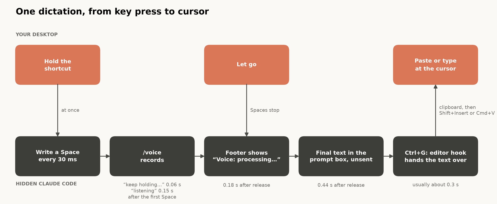
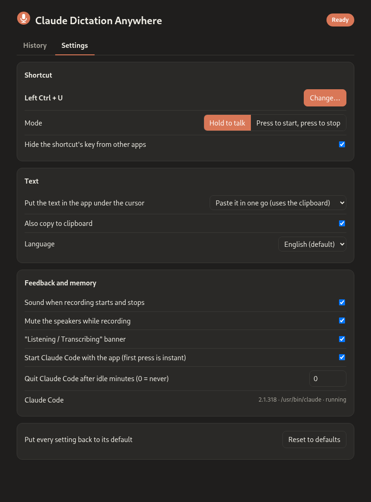

# Borrowing Claude Code's /voice dictation for every app

Claude Code has a `/voice` command: hold Space, talk, and the transcript appears in the prompt box. It is quick and accurate, and it comes with a Claude subscription. It does not use Claude messages or tokens, and it does not count toward usage limits. But it only works inside Claude Code, and I wanted it in a browser search box, in Slack, in email, and in a terminal.

[Claude Dictation Anywhere](https://github.com/GerardWu100/claude-dictation-anywhere) does that. Hold a shortcut, speak, let go, and the text appears at your cursor and on your clipboard. It runs on Linux (Wayland and X11) and macOS, and it is MIT-licensed. It is unofficial: Anthropic did not make it and is not affiliated with it. "Claude" and "Claude Code" are Anthropic's trademarks.

The shortcut can be any key, combination, or mouse button, in hold-to-talk or press-to-toggle mode. The app mutes your speakers while you talk, supports the 20 languages Claude Code's dictation supports, and bundles nothing. It needs no API key or extra account, because it uses the `claude` you already have.

The closest paid product I know is Wispr Flow. Its details below are as published in October 2026:

|  | Claude Dictation Anywhere | Wispr Flow |
|---|---|---|
| Price | Free with a Claude subscription you already have | Free tier capped at 2,000 words/week; Pro about \$15/month |
| Platforms | Linux (Wayland, X11), macOS | macOS, Windows; no Linux app listed |
| Speech engine | Claude Code's own `/voice` | Wispr's own service |
| Code | Source on GitHub | Closed |

On Windows, or without a Claude subscription, Wispr Flow is the better choice.

## Driving /voice from a hidden terminal

I could have read Claude Code's login token and called its voice service directly. I did not, because Anthropic's terms say subscription sign-in is meant for ordinary use of Claude Code itself, and a homemade client could put the account at risk. The app never reads credentials. It runs the real, unmodified `claude` in a pseudo-terminal (pty), a fake terminal one program can drive for another, and presses keys the way a person would.

A held Space bar in a terminal is just a Space character repeating about every 30 ms. Claude Code detects "held" from that rhythm, so the app imitates it:

```python
def _hold_space(self, session, press: Event, toggle: bool, started: float) -> None:
    while time.monotonic() - started < MAX_RECORDING_S and self._cancel_reason is None:
        if session.voice_failed():
            log.info("voice reported a failure; no more Spaces for this press")
            return
        session.press_space()
        try:
            event = self.events.get(timeout=KEY_REPEAT_INTERVAL_S)
        except queue.Empty:
            continue
        if toggle and event.kind == PRESS:
            return
        if not toggle and event.kind == RELEASE and event.gesture == press.gesture:
            return
```

The Spaces start the moment you press. In one measurement Claude Code was "listening" 0.15 s after the first Space, and words spoken before that are lost. The tray colour, banner, start sound, and mute take about 0.3 s together, so they run on another thread. And `voice_failed()` ends the loop at the first error notice, because every extra Space makes Claude Code try to connect again. One press gets one attempt.

The hidden session starts with everything except dictation turned off:

```python
CLAUDE_BASE_FLAGS = [
    "--safe-mode",
    "--strict-mcp-config",
    "--disable-slash-commands",
    "--tools",
    "",
]

def build_claude_args(claude_path: str, language: str) -> list[str]:
    settings = {"voice": {"enabled": True, "mode": "hold", "autoSubmit": False}}
    if language:
        settings["language"] = language
    return [claude_path, *CLAUDE_BASE_FLAGS, "--model", HIDDEN_SESSION_MODEL,
            "--settings", json.dumps(settings)]
```

Safe mode skips your `CLAUDE.md`, hooks, plugins, and MCP servers. With no tools, even a prompt sent by mistake could not touch a file. `autoSubmit: False` leaves the transcript unsent in the prompt box, so nothing reaches the model. The session also runs in its own empty folder, because Claude Code passes the folder name and git branch to dictation as word hints.

### Reading the screen

Before it presses anything, the app must know what Claude Code shows. Searching raw terminal output does not work: the output moves the cursor, overwrites cells, and erases lines. So the app feeds the bytes to [pyte](https://github.com/selectel/pyte), a terminal emulator library, and reads the rows it draws. The prompt box is a `❯` row directly under a horizontal rule; menus also draw `❯`, but never under a rule. Error notices are read from everything *except* the prompt box, otherwise dictating the words "no speech detected" would look like that error. On a screen it does not recognise, the app presses nothing.



The top lane is you; the bottom lane is the hidden Claude Code. The timings are single recordings from development, not benchmarks. The step that matters is deciding when the text is final: after release the footer shows "Voice: processing…", and the transcript counts as final only once that has appeared and gone. Waiting for a quiet screen is only the fallback, because quiet does not prove the text is complete.

### Getting the text out

Claude Code's Ctrl+G opens the prompt in your external editor, chosen by the `EDITOR` variable. The app sets `EDITOR` to a tiny script:

```python
EDITOR_HOOK_SCRIPT = """#!/bin/sh
set -eu
umask 077
for prompt_file in "$@"; do :; done
generation=$(cat "$CDA_HANDOFF_DIR/generation")
cp "$prompt_file" "$CDA_HANDOFF_DIR/result.$generation.partial"
mv "$CDA_HANDOFF_DIR/result.$generation.partial" "$CDA_HANDOFF_DIR/result.$generation"
: > "$prompt_file"
: > "$CDA_HANDOFF_DIR/done.$generation"
"""
```

The order matters. The script copies the text, publishes it with an atomic rename, and only then empties the prompt box. With `set -eu` a failed step stops the script with the earlier copies intact, so no failure can erase the only copy. Each recording has its own generation number, so a late file is never read as the next recording.

## Into the focused window

| | Shortcut | Clipboard | Insert |
|---|---|---|---|
| Linux, Wayland | evdev (kernel input devices) | `wl-copy` | `ydotool`: Shift+Insert, or key by key |
| Linux, X11 | evdev | `xclip` | same as Wayland |
| macOS | Quartz event tap | `pbcopy` | Quartz events: Cmd+V, or key by key |

Reading the kernel's input devices makes the Linux shortcut work the same on Wayland and X11. To stop the shortcut's key from also acting in the app in front, the app takes the device exclusively and replays every other event through a virtual twin; modifiers always pass, so Ctrl+C still works.

Paste is the default because typing one key per character can trigger a web page's shortcuts when the focus is not in a text box. Linux paste is Shift+Insert, not Ctrl+V, because terminals hand Ctrl+V to the program inside them. Some terminals, like GNOME Console and kitty, paste the *primary selection* on Shift+Insert, so the text goes there too. Linux type mode refuses non-US-keyboard text as a whole, because `ydotool` silently drops what it cannot type ("café" came out as "caf"). It also turns line breaks into spaces, since a typed line break is an Enter key that sends a chat message.

On macOS, the app notes which app is in front at release and checks again before inserting and every 32 characters while typing. Switch apps and typing stops. Wayland does not let a program read the focused window, so Linux has no such check.

## Never typed twice, nothing lost

Delivery reports what happened and never retries. A failure can come after part of the text is already in the app, and retyping would duplicate it, so the report says whether the text was copied, whether it was inserted, and whether the result is *uncertain*. Undelivered text goes to a list on the settings page, in memory only, with a Copy button. So does a transcript that did not finish within 12 s, or a failed hand-off; that text may be incomplete, so it is offered for copying and never typed. The app also waits for you to release the shortcut before typing, or a held Ctrl would turn the letters into shortcuts.



The settings page is served only on `127.0.0.1`, with a random token for each run. A second tab keeps your last 500 transcripts on your computer. Muting uses the output device's mute switch, so your volume level is untouched. Before it mutes, the app writes down which device it is muting, so a copy that crashed mid-recording unmutes that device on its next start. An output that was already muted stays muted. Feedback never takes focus: on Linux the banner is a desktop notification, and on macOS it is a non-activating panel that ignores clicks.

## Limits

- A Claude Code update can change the screen and break the app until it is updated. It was checked end to end with Claude Code 2.1.309 on macOS and 2.1.314 on Linux (GNOME on Wayland). The X11 path has not yet been tested on a real X11 session.
- One recording lasts at most about 2 minutes, Claude Code's own limit.
- The hidden Claude Code uses about 250 MB while it waits. You can let it quit when idle, but the next press then waits 1 to 3 s.
- Your audio goes to Anthropic exactly as with `/voice` in Claude Code. Anthropic's [Claude Code legal page](https://code.claude.com/docs/en/legal-and-compliance) allows signing in to the unmodified program for ordinary use, but does not settle using `/voice` transcripts elsewhere, and Anthropic has not endorsed this app. Use your own judgment.

To try it, you need Claude Code signed in with a Claude.ai account, Python 3.13+, and [uv](https://docs.astral.sh/uv/). Run `uv tool install git+https://github.com/GerardWu100/claude-dictation-anywhere`, then `claude-dictation-anywhere`. Linux also needs `ydotool` and `wl-clipboard` or `xclip`; macOS needs the Input Monitoring, Accessibility, and Microphone permissions. The [repository](https://github.com/GerardWu100/claude-dictation-anywhere) and its wiki cover the rest.
